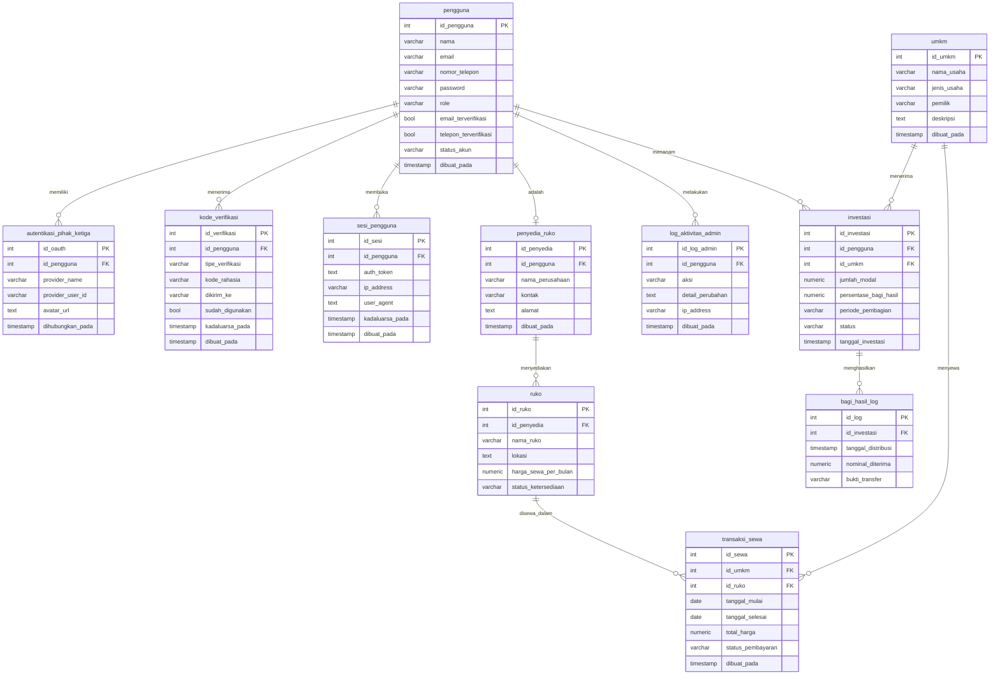

# Kamus Data & Spesifikasi ERD Sistem

Arsitektur basis data relasional untuk platform investasi UMKM dan sewa ruko. Mencakup sistem keamanan *Hybrid Authentication* (Google OAuth & OTP) serta akuntabilitas manajemen data oleh Admin/Super Admin/Penyedia Ruko.

**Legenda:** PK = Primary Key, FK = Foreign Key. Relasi 1 — N (one-to-many).

## Diagram

---

## Bagian 1: Autentikasi & Pengguna

### 1. Tabel: `pengguna`

Menyimpan data akun seluruh aktor sistem (Super Admin, Admin, dan Investor).

| Nama Kolom | Tipe Data | Keterangan |
|---|---|---|
| **PK** `id_pengguna` | SERIAL | Primary Key (Otomatis) |
| `nama` | VARCHAR(100) | Nama pengguna (diambil dari Google OAuth atau input manual) |
| `email` | VARCHAR(100) | Email unik terdaftar (digunakan untuk login) |
| `nomor_telepon` | VARCHAR(20) | Nomor HP aktif (bisa kosong sebelum diverifikasi OTP) |
| `password` | VARCHAR(255) | Hash kata sandi. Nullable (kosong jika murni daftar via Google) |
| `role` | VARCHAR(20) | Kategori hak akses: `super_admin`, `admin`, `investor`, `penyedia_ruko` |
| `email_terverifikasi` | BOOLEAN | TRUE jika mendaftar via Google atau sudah verifikasi link email. Default: FALSE |
| `telepon_terverifikasi` | BOOLEAN | TRUE setelah kode OTP nomor telepon sukses divalidasi. Default: FALSE |
| `status_akun` | VARCHAR(20) | Status operasional: `aktif`, `ditangguhkan`, `menunggu_verifikasi` |
| `dibuat_pada` | TIMESTAMP | Waktu registrasi pertama kali |

### 2. Tabel: `autentikasi_pihak_ketiga`

Menyimpan token integrasi eksternal untuk pengguna yang memilih metode "Masuk dengan Google".

| Nama Kolom | Tipe Data | Keterangan |
|---|---|---|
| **PK** `id_oauth` | SERIAL | Primary Key |
| **FK** `id_pengguna` | INT | Foreign Key ke tabel `pengguna` |
| `provider_name` | VARCHAR(50) | Identitas penyedia, contoh: `google` |
| `provider_user_id` | VARCHAR(255) | ID unik konstan milik pengguna yang diterbitkan oleh Google |
| `avatar_url` | TEXT | Tautan gambar profil bawaan dari akun Google pengguna |
| `dihubungkan_pada` | TIMESTAMP | Waktu sinkronisasi akun dengan Google |

### 3. Tabel: `kode_verifikasi`

Sentralisasi data kode OTP (WhatsApp/SMS) dan token aktivasi email konvensional beserta masa kedaluwarsanya.

| Nama Kolom | Tipe Data | Keterangan |
|---|---|---|
| **PK** `id_verifikasi` | SERIAL | Primary Key |
| **FK** `id_pengguna` | INT | Foreign Key ke tabel `pengguna` |
| `tipe_verifikasi` | VARCHAR(20) | Jenis validasi: `otp_telepon` atau `link_email` |
| `kode_rahasia` | VARCHAR(255) | 6 digit angka OTP atau string token aktivasi email |
| `dikirim_ke` | VARCHAR(100) | Salinan tujuan pengiriman (nomor telepon / alamat email) |
| `sudah_digunakan` | BOOLEAN | Status penggunaan kode/token. Default: FALSE |
| `kadaluarsa_pada` | TIMESTAMP | Batas waktu validitas kode (OTP hangus < 5 menit) |
| `dibuat_pada` | TIMESTAMP | Waktu pembuatan dan pengiriman kode |

### 4. Tabel: `sesi_pengguna`

Melacak token sesi aktif (JWT/Session ID) setiap kali aktor berhasil login ke aplikasi.

| Nama Kolom | Tipe Data | Keterangan |
|---|---|---|
| **PK** `id_sesi` | SERIAL | Primary Key |
| **FK** `id_pengguna` | INT | Foreign Key ke tabel `pengguna` |
| `auth_token` | TEXT | Token keamanan internal sistem untuk otorisasi API |
| `ip_address` | VARCHAR(45) | Alamat IP perangkat pendaftar/pengakses |
| `user_agent` | TEXT | Informasi browser dan jenis perangkat pengguna |
| `kadaluarsa_pada` | TIMESTAMP | Batas waktu masa aktif sesi login |
| `dibuat_pada` | TIMESTAMP | Waktu login dilakukan |

---

## Bagian 2: Entitas Bisnis & Transaksi

### 5. Tabel: `penyedia_ruko`

Data korporasi atau perorangan yang menyewakan aset properti ruko, terhubung dengan akun pengguna untuk otentikasi dan otorisasi.

| Nama Kolom | Tipe Data | Keterangan |
|---|---|---|
| **PK** `id_penyedia` | SERIAL | Primary Key |
| **FK** `id_pengguna` | INT | Foreign Key ke tabel `pengguna` (wajib user ber-role `penyedia_ruko`) |
| `nama_perusahaan` | VARCHAR(150) | Nama perusahaan atau pemilik properti ruko |
| `kontak` | VARCHAR(20) | Nomor telepon resmi penyedia |
| `alamat` | TEXT | Alamat fisik kantor pusat penyedia ruko |
| `dibuat_pada` | TIMESTAMP | Waktu pendataan entitas |

### 6. Tabel: `ruko`

Informasi fisik ruko komersial yang tersedia untuk disewakan kepada pelaku usaha.

| Nama Kolom | Tipe Data | Keterangan |
|---|---|---|
| **PK** `id_ruko` | SERIAL | Primary Key |
| **FK** `id_penyedia` | INT | Foreign Key ke tabel `penyedia_ruko` |
| `nama_ruko` | VARCHAR(100) | Identitas nama properti atau nomor blok ruko |
| `lokasi` | TEXT | Titik lokasi atau alamat lengkap ruko |
| `harga_sewa_per_bulan` | NUMERIC(12,2) | Tarif dasar sewa bulanan dalam Rupiah |
| `status_ketersediaan` | VARCHAR(20) | Status terkini: `tersedia`, `tersewa`, `maintenance` |

### 7. Tabel: `umkm`

Profil data usaha mikro yang dikelola dan berhak menerima investasi atau menyewa properti.

| Nama Kolom | Tipe Data | Keterangan |
|---|---|---|
| **PK** `id_umkm` | SERIAL | Primary Key (Otomatis) |
| `nama_usaha` | VARCHAR(150) | Nama resmi merek dagang/badan usaha |
| `jenis_usaha` | VARCHAR(100) | Kategori sektor bisnis (Kuliner, Kriya, Fashion, dll) |
| `pemilik` | VARCHAR(100) | Nama pemilik usaha |
| `deskripsi` | TEXT | Rencana bisnis atau profil singkat komoditas usaha |
| `dibuat_pada` | TIMESTAMP | Waktu registrasi entitas bisnis |

### 8. Tabel: `transaksi_sewa`

Mencatat durasi sewa, riwayat sewa, serta nilai kontrak penyewaan ruko oleh pihak UMKM.

| Nama Kolom | Tipe Data | Keterangan |
|---|---|---|
| **PK** `id_sewa` | SERIAL | Primary Key |
| **FK** `id_umkm` | INT | Foreign Key ke tabel `umkm` |
| **FK** `id_ruko` | INT | Foreign Key ke tabel `ruko` |
| `tanggal_mulai` | DATE | Hari pertama kontrak sewa berjalan (Awal Durasi) |
| `tanggal_selesai` | DATE | Hari berakhirnya masa sewa (Akhir Durasi) |
| `total_harga` | NUMERIC(12,2) | Akumulasi biaya sewa berdasarkan durasi waktu kontrak |
| `status_pembayaran` | VARCHAR(20) | Status tagihan sewa: `pending`, `lunas`, `dibatalkan` |
| `dibuat_pada` | TIMESTAMP | Waktu transaksi ini diterbitkan |

### 9. Tabel: `investasi`

Kontrak kesepakatan penanaman modal finansial dan penentuan porsi sistem bagi hasil antara Investor dan UMKM.

| Nama Kolom | Tipe Data | Keterangan |
|---|---|---|
| **PK** `id_investasi` | SERIAL | Primary Key |
| **FK** `id_pengguna` | INT | Foreign Key ke tabel `pengguna` (wajib user ber-role `investor`) |
| **FK** `id_umkm` | INT | Foreign Key ke tabel `umkm` |
| `jumlah_modal` | NUMERIC(15,2) | Total dana modal yang disetorkan investor |
| `persentase_bagi_hasil` | NUMERIC(5,2) | Nilai pembagian laba yang dijanjikan (contoh: 12.50 berarti 12.5%) |
| `periode_pembagian` | VARCHAR(20) | Jadwal distribusi bagi hasil: `bulanan` atau `tahunan` |
| `status` | VARCHAR(20) | Status lembar investasi: `aktif`, `selesai`, `ditangguhkan` |
| `tanggal_investasi` | TIMESTAMP | Waktu kontrak investasi ini sah ditandatangani |

### 10. Tabel: `bagi_hasil_log`

Riwayat pembagian dividen berkala yang ditransfer kepada investor berdasarkan performa UMKM.

| Nama Kolom | Tipe Data | Keterangan |
|---|---|---|
| **PK** `id_log` | SERIAL | Primary Key |
| **FK** `id_investasi` | INT | Foreign Key ke tabel `investasi` |
| `tanggal_distribusi` | TIMESTAMP | Tanggal pengiriman profit sharing ke rekening investor |
| `nominal_diterima` | NUMERIC(15,2) | Jumlah nominal uang bagi hasil yang dibayarkan |
| `bukti_transfer` | VARCHAR(255) | Tautan/path menuju dokumen digital bukti transfer perbankan |

---

## Bagian 3: Tata Kelola Internal & Audit Trail

### 11. Tabel: `log_aktivitas_admin`

Merekam jejak operasional mutlak yang dijalankan oleh Admin atau Super Admin untuk audit internal dan transparansi.

| Nama Kolom | Tipe Data | Keterangan |
|---|---|---|
| **PK** `id_log_admin` | SERIAL | Primary Key |
| **FK** `id_pengguna` | INT | Foreign Key ke tabel `pengguna` (wajib user ber-role `admin` atau `super_admin`) |
| `aksi` | VARCHAR(100) | Bentuk tindakan pengelola, misal: `MENYETUJUI_INVESTASI`, `BAN_AKUN_INVESTOR` |
| `detail_perubahan` | TEXT | Rekaman riwayat perubahan objek (struktur JSON sebelum dan sesudah dimodifikasi) |
| `ip_address` | VARCHAR(45) | Alamat IP dari gawai komputer pengelola yang bertugas |
| `dibuat_pada` | TIMESTAMP | Waktu presisi eksekusi tindakan admin dilakukan |
